<div align="center">


<br/>


-ff7a00?style=flat-square)


</div>

<br/>

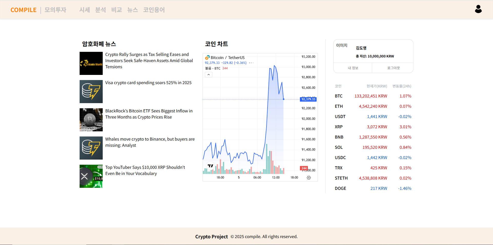

## 📌 프로젝트 소개

**COMPILE**은 암호화폐에 익숙하지 않은 사람도 가상 자산으로 부담 없이 투자를 연습할 수 있는 **암호화폐 모의투자 플랫폼**입니다.

| 문제 | 해결 |
|---|---|
| 기존 거래소는 전문가 중심이라 용어와 화면이 복잡함 | 입문자도 쉽게 쓸 수 있는 화면 구성과 **코인 용어 사전** 제공 |
| 정보가 너무 많고 흩어져 있음 | 시세·차트·뉴스·AI 분석을 **한 플랫폼**에 모음 |
| 연습 없이 실전 투자를 하면 손실 위험이 큼 | 회원가입 시 **가상 자산 1천만 원**을 지급하는 리스크 없는 모의투자 |

<br/>

## ✨ 주요 기능

| 기능 | 설명 |
|---|---|
| 💰 **모의투자** | 상위 20개 코인을 KRW 기준 시세로 매수·매도하고, 거래 내역을 코인·유형별로 검색 |
| 📊 **포트폴리오** | 총 자산, 보유 원화, 손익, 수익률과 코인별 평균 매수가·평가 금액을 실시간 시세로 계산하고 파이 차트로 표시 |
| 🏆 **랭킹 보드** | 총 자산순·수익률순으로 사용자 순위 비교 (Oracle `RANK()` 함수 활용) |
| 📈 **시세 / 상세** | CoinGecko 시세와 한국수출입은행 환율을 결합해 원화로 표시하고, TradingView 캔들 차트 제공 |
| 🤖 **AI 분석** | 시가총액·거래량·변동률을 바탕으로 Gemini가 종합 평가, 트렌드, 긍정·부정 요인, 결론을 정리 |
| ⚖️ **코인 비교** | 최대 4개 코인을 골라 가격 변동 그래프를 한 화면에서 비교 |
| 📰 **뉴스** | CoinDesk 최신 뉴스 50개를 페이지네이션으로 제공하고, 제목은 Gemini로 한글 번역 |
| 📖 **코인 용어 사전** | 키워드 검색, 추천 검색어, 카테고리(기술·자산·거래) 필터, 연관 용어 연결 |
| 🔐 **회원 기능** | 회원가입(아이디·이메일·전화번호 중복 검증), 로그인, 비밀번호 찾기·재설정 |

<br/>

## 🖥️ 화면

<table>
  <tr>
    <td align="center"><b>모의투자</b></td>
    <td align="center"><b>포트폴리오</b></td>
  </tr>
  <tr>
    <td>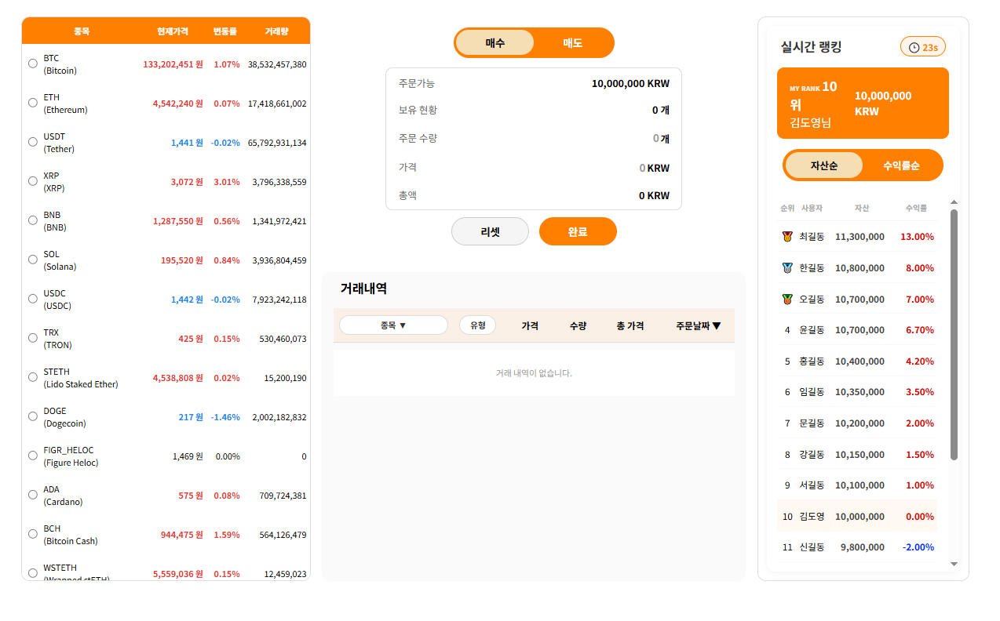</td>
    <td>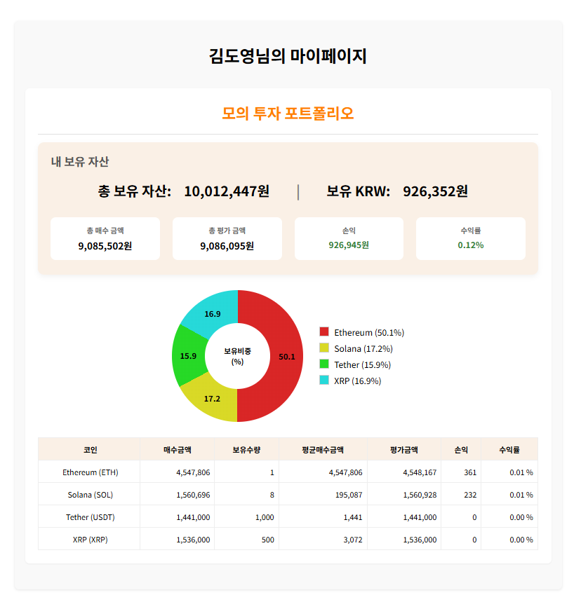</td>
  </tr>
  <tr>
    <td align="center"><b>매수</b></td>
    <td align="center"><b>매도</b></td>
  </tr>
  <tr>
    <td>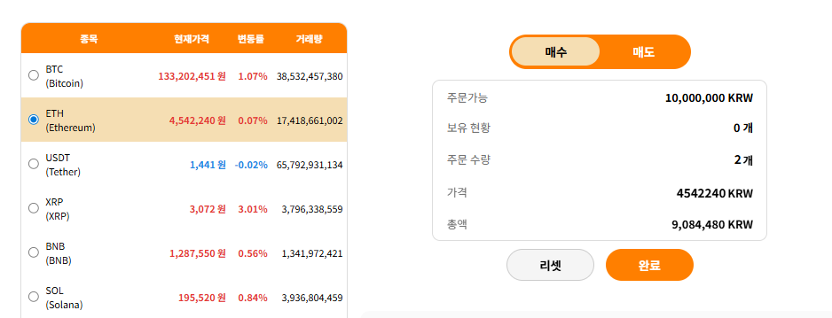</td>
    <td>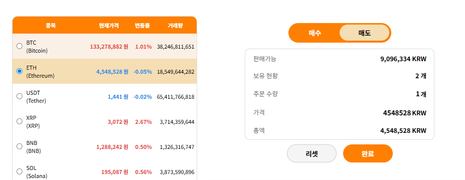</td>
  </tr>
  <tr>
    <td align="center"><b>암호화폐 시세</b></td>
    <td align="center"><b>시세 상세 (TradingView)</b></td>
  </tr>
  <tr>
    <td>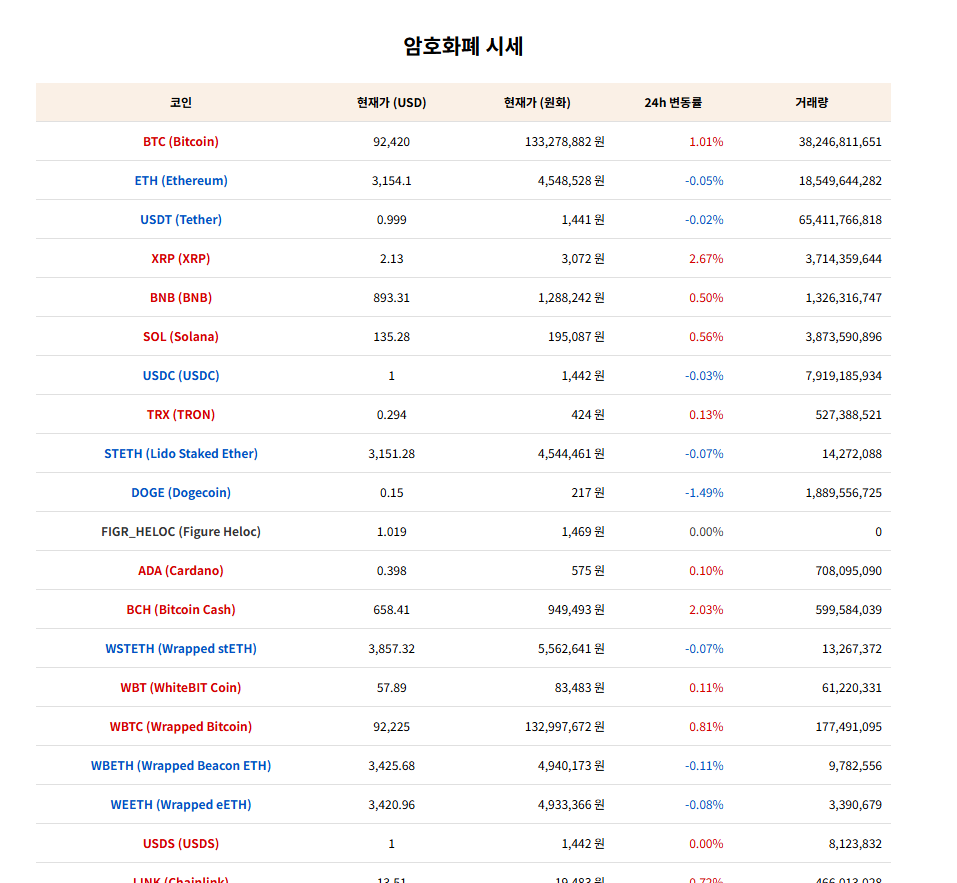</td>
    <td>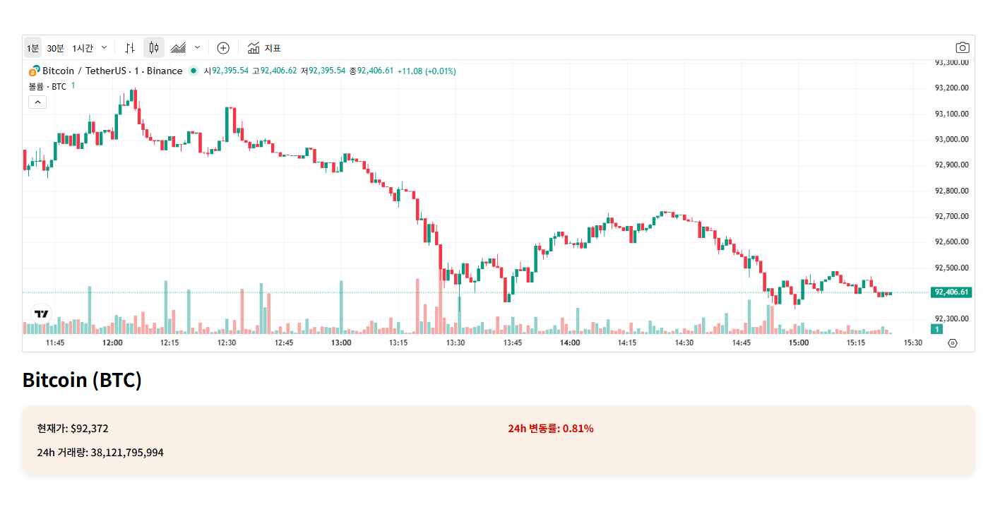</td>
  </tr>
  <tr>
    <td align="center"><b>AI 분석</b></td>
    <td align="center"><b>코인 비교</b></td>
  </tr>
  <tr>
    <td>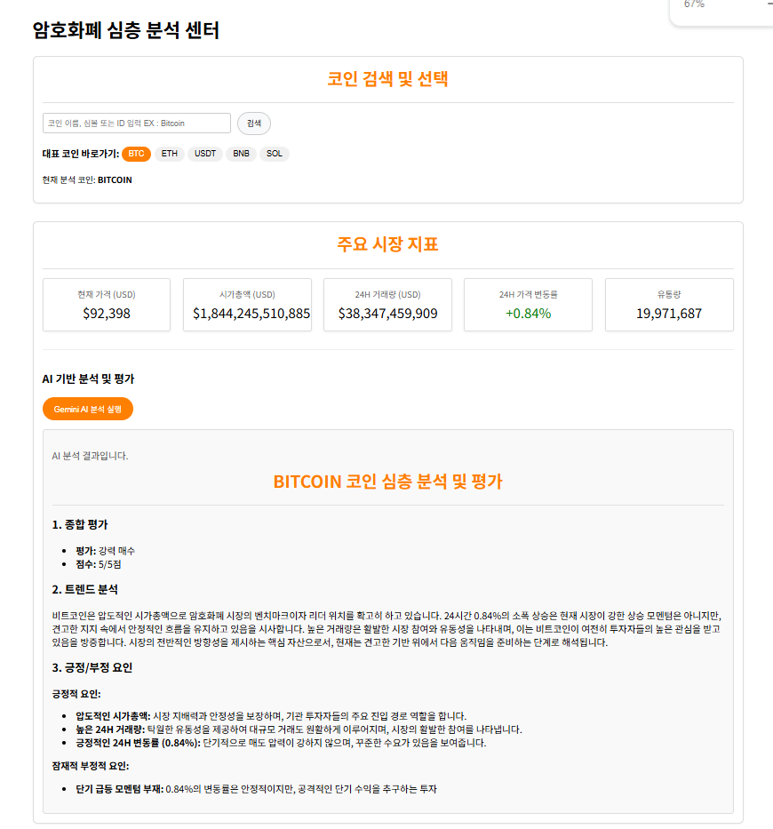</td>
    <td>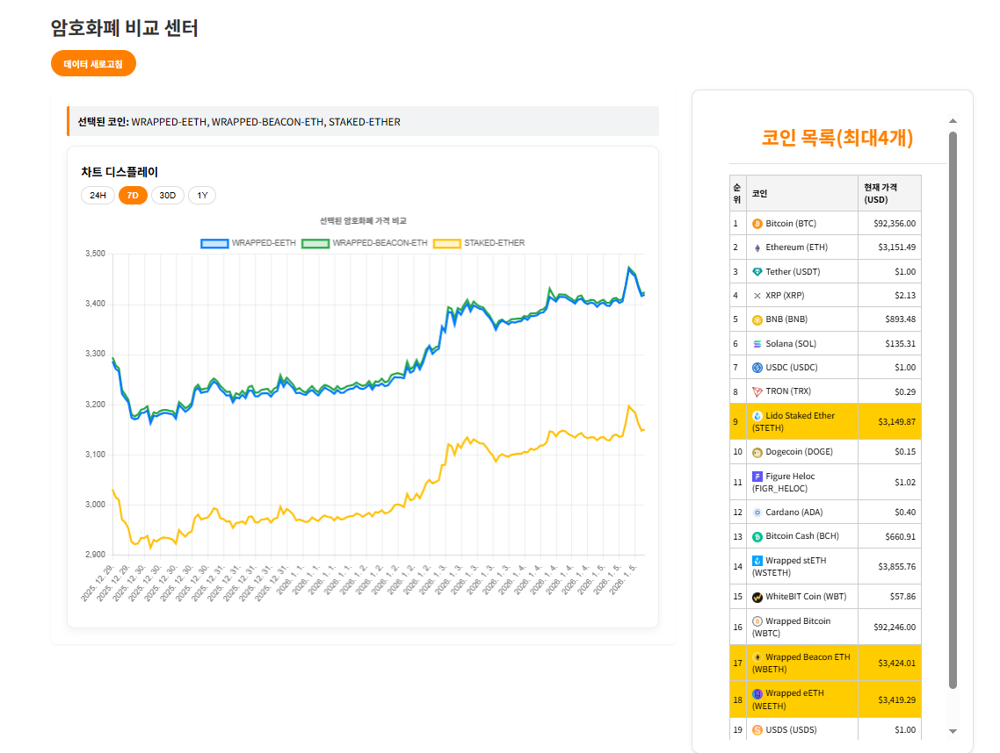</td>
  </tr>
</table>

<details>
<summary><b>거래 내역 · 랭킹 화면 더 보기</b></summary>
<br/>
<p align="center">
  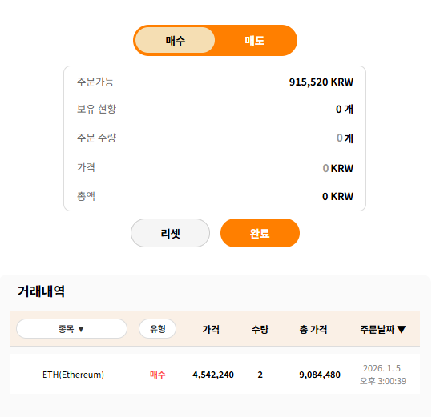
  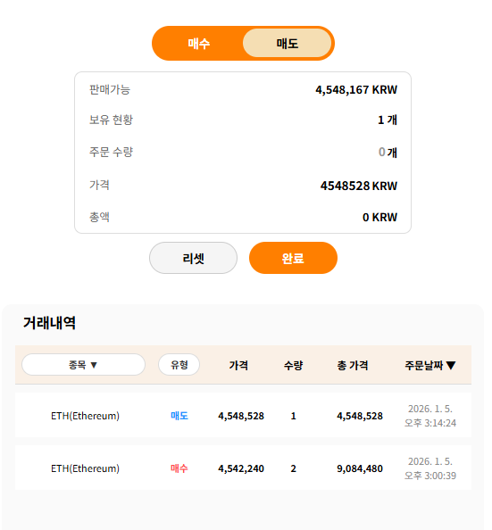
  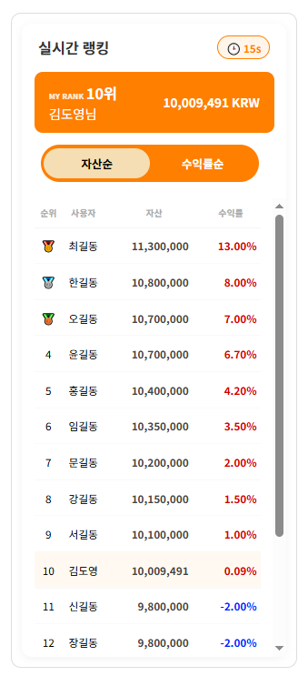
</p>
</details>

<br/>

## 🛠️ 기술 스택

| 구분 | 기술 |
|---|---|
| **Backend** |     -6DB33F?style=flat-square&logo=spring&logoColor=white)   |
| **Frontend** |       |
| **Database** |  |
| **External API** |      |
| **Tools** |     |

<br/>

## 🏗️ 시스템 구조

```
┌──────────┐   요청    ┌──────────────────┐   REST API   ┌─────────────────────────┐   JPA    ┌────────────┐
│   User   │ ───────▶ │  React (Client)  │ ───────────▶ │  Spring Boot (Server)   │ ───────▶ │ Oracle DB  │
│ (브라우저) │ ◀─────── │  Router · Context │ ◀─────────── │ Controller·Service·Repo │ ◀─────── │ USERS 외 3 │
└──────────┘   화면    └──────────────────┘     JSON     └────────────┬────────────┘          └────────────┘
                                                                     │ WebClient + Caffeine Cache
                                                                     ▼
                                   CoinGecko · 한국수출입은행 환율 · CoinDesk · Gemini · TradingView
```

### ERD

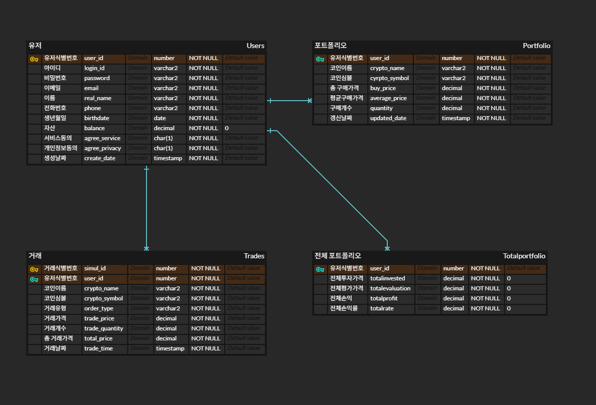

`USERS` · `TRADES` · `PORTFOLIO` · `TOTALPORTFOLIO` 4개 테이블로 사용자, 거래, 코인별 보유 현황, 총 자산을 관리합니다.

<br/>

## 👥 팀원 및 역할

| 이름 | 역할 | 담당 |
|---|---|---|
| **김도영** | 팀장 | 데이터·UI 설계(ERD), 메인 페이지, 로그인·회원가입 백엔드, 모의투자(매수·매도), 포트폴리오, 뉴스 페이지 |
| 박선호 | 팀원 | 시세·상세 페이지 (CoinGecko + 환율 API, TradingView 차트) |
| 김진용 | 팀원 | 분석·비교 페이지, Gemini AI 분석, 뉴스 제목 번역 |
| 김현준 | 팀원 | 코인 용어 사전 |
| 김원진 | 팀원 | 실시간 랭킹 시스템 (JdbcTemplate, Oracle `RANK()`) |
| 김민서 | 팀원 | 회원가입·로그인 화면(UI)과 입력값 검증 |

### 🙋 내가 맡은 부분 (김도영)

- **모의투자 거래 로직**: `@Transactional`로 *거래 생성 → 거래 내역 저장 → 잔액 갱신 → 포트폴리오 반영*을 하나의 트랜잭션으로 묶어 데이터 정합성을 지켰습니다.
- **포트폴리오**: 거래가 생기면 코인별 포트폴리오를 자동으로 만들거나 갱신하고, 실시간 시세로 평가 금액·손익·수익률과 총 자산을 다시 계산합니다.
- **회원가입·로그인 API**: 아이디·이메일·전화번호 중복을 검증하고, 가입하면 가상 자산 1천만 원을 지급합니다. 로그인 상태는 React Context API와 `sessionStorage`로 관리해 새로고침해도 유지됩니다.
- **메인 대시보드**: 뉴스, 차트, 시세, 사용자 자산을 한 화면에 모았고, 로그인 여부에 따라 화면과 접근 권한이 달라집니다.
- **뉴스 페이지**: CoinDesk 뉴스를 카드 형태로 보여주고, 페이지네이션을 직접 구현했습니다.

<br/>

## 🧩 한계와 개선 방향

| 한계 | 개선 방향 |
|---|---|
| 외부 API 호출 횟수 제한 때문에 코인을 20개로 제한 | 페이지네이션과 캐싱을 적용해 전체 코인을 안정적으로 불러오고 거래 지원 종목 확대 |
| API 요청이 많아 실시간 시세 반영이 늦어짐 | WebSocket으로 전환하고 요청 주기를 최적화 |

<br/>

## 🚀 실행 방법

```bash
# 1. 저장소 받기
git clone https://github.com/doyoung040257/Crypto_Project.git
cd Crypto_Project/Crypto_Project

# 2. 백엔드 (Java 17, Oracle XE 필요)
#    src/main/resources/application.properties에 DB 정보와 API 키를 넣어 주세요.
cd backend
./gradlew bootRun        # Windows: gradlew.bat bootRun

# 3. 프론트엔드 (새 터미널)
cd ../frontend
npm install
npm start                # http://localhost:3000
```

필요한 API 키: CoinGecko, 한국수출입은행 환율, CoinDesk, Gemini

<br/>

## 📎 자료

- 📑 [발표 자료 (PDF)](docs/Compile_presentation.pdf)

<div align="center">


</div>
